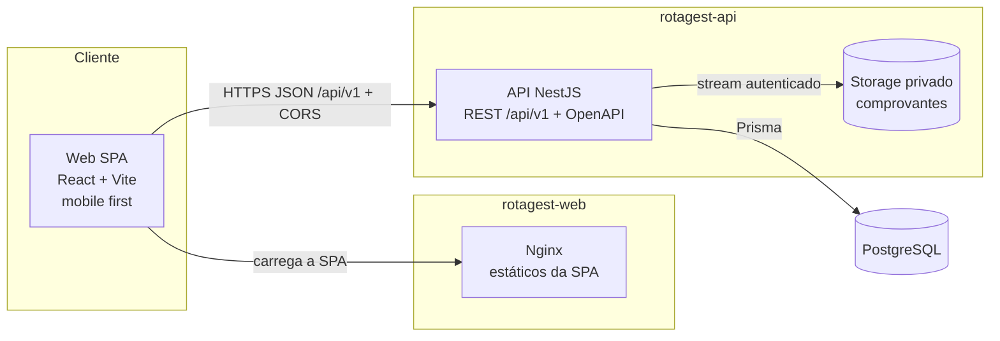
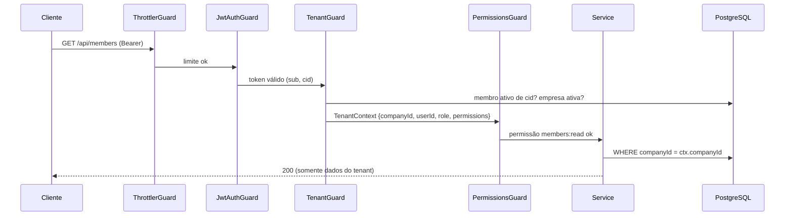
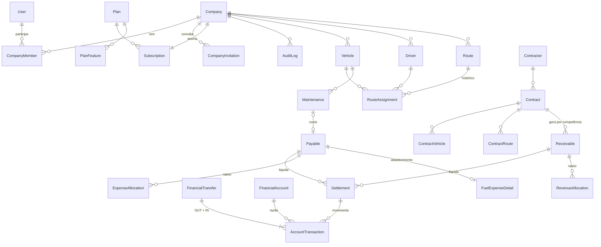

# RotaGest — Análise e Arquitetura

> Documento de referência técnica. Responde aos itens 1 a 8 da seção 27 do pedido
> (análise, arquitetura, diretórios, banco, multi-tenant, regras financeiras,
> autenticação e plano). O schema Prisma real está em
> [`prisma/schema.prisma`](../prisma/schema.prisma) e as
> restrições extras em `prisma/migrations/*_integrity_constraints`.
>
> O RotaGest é composto por **dois repositórios independentes**: `rotagest-api`
> (este, dono de todas as regras) e `rotagest-web` (SPA). Eles se comunicam só
> por HTTP/JSON em `/api/v1`, com o contrato OpenAPI como fonte dos tipos.

Sumário

1. [Análise dos requisitos](#1-análise-dos-requisitos)
2. [Arquitetura proposta](#2-arquitetura-proposta)
3. [Estrutura de diretórios](#3-estrutura-de-diretórios)
4. [Modelagem do banco de dados](#4-modelagem-do-banco-de-dados)
5. [Estratégia multi-tenant](#5-estratégia-multi-tenant)
6. [Regras de cálculo financeiro](#6-regras-de-cálculo-financeiro)
7. [Autenticação e autorização](#7-autenticação-e-autorização)
8. [Plano de implementação](#8-plano-de-implementação)

---

## 1. Análise dos requisitos

### 1.1 Problema

Transportadores pequenos (o primeiro cliente tem duas vans escolares) controlam
receitas de contratos e dezenas de tipos de despesa manualmente. Não sabem
**quanto cada veículo recebe, quanto custa e qual resultado gera**. O produto
precisa responder isso com exatidão e, depois, escalar para frotas maiores,
outros tipos de transporte (fretamento, corporativo, municipal) e muitas
empresas na mesma plataforma.

### 1.2 Atores

| Ator | Escopo | Observação |
|---|---|---|
| SUPER_ADMIN | Plataforma | Gerencia empresas, planos e assinaturas. **Não** vê dados financeiros das empresas por padrão. |
| OWNER | Empresa | Tudo dentro da empresa, inclusive membros, fechamento e reabertura. |
| MANAGER | Empresa | Operacional; permissões configuráveis por membro. |
| FINANCIAL | Empresa | Receitas, despesas, contas, relatórios. |
| DRIVER | Empresa | Suas atribuições e seus próprios gastos (com aprovação). |

`SUPER_ADMIN` é um **papel de plataforma** (`User.platformRole`), não um papel
de empresa. Os outros quatro são papéis de **membro** (`CompanyMember.role`): o
mesmo usuário pode ser OWNER na empresa A e DRIVER na empresa B.

### 1.3 Requisitos funcionais agrupados

| Domínio | Núcleo | Fase |
|---|---|---|
| Core SaaS | Empresas (CPF/CNPJ), onboarding, membros, convites, troca de empresa | 1 |
| Comercial | Planos, limites configuráveis, assinaturas, painel da plataforma | 1 (base) / 5 |
| Cadastros | Veículos, motoristas, rotas e atribuições temporais, contratantes, contratos | 2–3 |
| Financeiro | Categorias, contas financeiras, contas a pagar/receber, liquidações parciais, transferências, recorrência, parcelamento | 2 |
| Gerencial | Rateios, resultado por veículo/rota/contrato, manutenção, combustível | 3 |
| Fechamento e relatórios | Fechamento mensal com snapshot e bloqueio, 10 relatórios, PDF/Excel | 4 |

### 1.4 Requisitos não funcionais

- **Isolamento entre empresas** é o requisito mais crítico: um vazamento entre
  tenants invalida o produto comercialmente.
- **Exatidão financeira**: Decimal em todo o caminho (banco, API e cálculo),
  operações atômicas, idempotência, nenhuma dupla contagem (rateio,
  manutenção → despesa, transferências).
- **Auditabilidade**: histórico preservado; nada financeiro é apagado; fechamento
  com snapshot; reabertura justificada.
- **Mobile first**: o motorista e o dono usam o celular; o financeiro usa desktop.
- **Simplicidade de uso**: o primeiro cliente não é contador. A linguagem da
  interface é "recebi", "paguei", "a receber", "a pagar", não jargão contábil.

### 1.5 Decisões tomadas onde o pedido deixa margem

| Tema | Decisão | Motivo |
|---|---|---|
| Status "Vencida" | **Derivado**, não persistido (`dueDate < hoje` e saldo em aberto). | Um status gravado ficaria errado no dia seguinte sem um job. |
| Saldo de conta | **Calculado** a partir do razão `AccountTransaction`. | Fonte única de verdade; sem saldo duplicado. |
| `paidAmount`/`receivedAmount` | Cache na obrigação, atualizado na mesma transação da liquidação, sob `SELECT … FOR UPDATE`. Reconciliação por consulta (§6.4). | Listagens rápidas sem perder a fonte de verdade (Settlements). |
| Manutenção × despesa | O custo vive só no `Payable`; a manutenção é registro operacional que aponta para ele. | Evita custo em dobro. |
| Combustível | Um `Payable` da categoria Combustível + `FuelExpenseDetail` (litros, preço, km). | Uma obrigação, um custo; o detalhe serve aos relatórios de consumo. |
| Empresa ativa | Claim `cid` no access token, revalidada no banco a cada requisição. | O frontend nunca escolhe o tenant sozinho; trocar de empresa emite um token novo. |
| Gasto do motorista | Cria `Payable` com `approvalStatus = PENDING_APPROVAL`. | O motorista registra; o financeiro aprova antes de entrar nos relatórios. |
| Fornecedor | Campo texto (`supplierName`) na v1. | O pedido não lista entidade Supplier; vira entidade quando houver demanda. |
| Row-Level Security | Aplicada na Fase 6 (§5.7), com o papel `rotagest_app` e testes próprios. | O pedido condiciona RLS a integração correta e testada com o Prisma. |
| E-mail | Interface `MailService`; com `SMTP_URL` envia por SMTP, sem ela registra no log (e avisa na subida em produção). | Não fingir envio de e-mail sem provedor configurado. |

### 1.6 Riscos

| Risco | Mitigação |
|---|---|
| Esquecer o filtro de tenant numa consulta | `TenantContext` obrigatório nos serviços de negócio, FKs compostas no banco, testes de acesso cruzado por módulo e RLS na Fase 6. |
| Liquidação duplicada (duplo clique, retry de rede) | `idempotencyKey` única por empresa + lock da obrigação. |
| Arredondamento em rateios | Algoritmo de maior resto em centavos (§6.6); soma sempre igual ao total. |
| Edição de período fechado | `PeriodLockService` chamado em toda escrita financeira; teste dedicado. |
| Token roubado | Access curto (15 min), refresh rotativo com detecção de reuso, cookie `HttpOnly`. |

---

## 2. Arquitetura proposta

### 2.1 Visão geral



- **Monólito modular** (NestJS): um deploy, módulos com fronteiras claras.
  Para o tamanho do produto, microserviços só trariam custo operacional.
- **SPA** em React servida como estáticos, em repositório e deploy próprios;
  toda regra de negócio, validação definitiva e persistência estão na API.
- **Contrato**: a API publica OpenAPI (`/api/docs-json` e `openapi.json`
  versionado); o web gera seus tipos com `openapi-typescript`, sem DTOs
  duplicados à mão. Um teste da API falha se `openapi.json` ficar desatualizado.
- **Versionamento**: todas as rotas em `/api/v1`; mudanças incompatíveis vão
  para `/api/v2` convivendo com a v1 até o web migrar.
- **PostgreSQL compartilhado** com isolamento lógico por `companyId`.
- **Comprovantes** em storage privado (disco/volume na v1, S3 compatível
  depois), sempre baixados via API autenticada; nunca URL pública.

### 2.2 Pipeline de uma requisição na API



Ordem dos guards globais: `Throttler → JwtAuth → Tenant → Permissions`.
Rotas marcadas com `@Public()` pulam autenticação; rotas com `@NoTenant()`
exigem usuário autenticado mas não empresa (ex.: listar minhas empresas,
criar empresa, aceitar convite).

### 2.3 Camadas do backend

| Camada | Responsabilidade | Não faz |
|---|---|---|
| Controller | HTTP, DTOs, Swagger, decorators de permissão | Regra de negócio |
| Service | Regras, transações, auditoria | Conhecer HTTP |
| Prisma (repositório) | Persistência; consultas sempre com `companyId` do contexto | Decidir permissões |
| Guards/Interceptors | Autenticação, tenant, RBAC, logs | Regras de domínio |
| `src/domain` | Papéis, permissões, CPF/CNPJ (regras puras, sem I/O). O web recebe o catálogo por `GET /api/v1/meta/access-control`. | Acesso a banco |

Abstrações de repositório só entram onde há ganho real (ex.: `LedgerRepository`
com consultas de saldo em SQL). Nos CRUDs, o `PrismaService` é usado direto no
service, sempre com o escopo do tenant.

### 2.4 Frontend

- Organização por **feature** (`src/features/<feature>`), cada uma com páginas,
  componentes, hooks de query e schemas.
- **TanStack Query** para estado de servidor; nenhum mock permanente.
- **React Hook Form + Zod** em formulários, para retorno imediato (CPF/CNPJ,
  senha); a API revalida tudo. Tipos de requisição/resposta vêm do OpenAPI.
- **Cliente HTTP** único (`src/api/client.ts`) com URL da API em `VITE_API_URL`,
  Bearer, renovação de sessão e erros padronizados.
- **Access token só em memória**; o refresh vive em cookie `HttpOnly`. O cliente
  HTTP renova o token uma única vez por 401, com fila de requisições pendentes.
- Guards de rota: `RequireAuth → RequireCompany → RequirePermission`. A
  interface esconde o que o usuário não pode fazer; a API é quem garante.
- Layout: sidebar recolhível (≥ md) e bottom navigation (< md); tema
  claro/escuro com a paleta do pedido em tokens CSS; componentes no padrão
  shadcn/ui (Radix + Tailwind + CVA) dentro de `src/components/ui`.

---

## 3. Estrutura de diretórios

Dois repositórios Git independentes, cada um com `package.json`, lockfile,
`.env.example`, Dockerfile e histórico próprios. Não há workspace nem
dependência de código entre eles.

```
rotagest-api/                        # backend (este repositório)
├── prisma/
│   ├── schema.prisma                # modelo completo (todas as fases)
│   ├── migrations/                  # versionadas
│   └── seed.ts                      # planos padrão + super admin opcional
├── src/
│   ├── main.ts · app.module.ts · setup-app.ts   # /api/v1, CORS, Swagger
│   ├── config/                      # validação de env (Zod)
│   ├── domain/                      # papéis, permissões, CPF/CNPJ
│   ├── common/                      # guards, decorators, filtros, tenant, DTOs de erro/enums
│   ├── prisma/                      # PrismaService
│   └── modules/
│       ├── auth/ companies/ memberships/ subscriptions/ audit/ mail/ meta/ health/
│       ├── vehicles/ drivers/ routes/ contracts/                    (fases 2–3)
│       ├── financial-accounts/ payables/ receivables/              (fase 2)
│       ├── settlements/ transactions/ allocations/                 (fases 2–3)
│       ├── maintenance/ dashboard/ reports/ monthly-closings/      (fases 2–4)
│       └── platform/                                               (fase 5)
├── scripts/export-openapi.ts        # gera openapi.json sem banco
├── openapi.json                     # contrato versionado
├── test/                            # e2e com PostgreSQL real
├── docs/                            # arquitetura, segurança, relatórios de fase
├── Dockerfile · docker-compose.yml  # API + PostgreSQL
└── .env.example

rotagest-web/                        # frontend
├── src/
│   ├── api/
│   │   ├── schema.d.ts              # GERADO do OpenAPI (npm run api:types)
│   │   ├── types.ts                 # aliases legíveis dos schemas gerados
│   │   └── client.ts                # cliente HTTP: base URL por env, Bearer, refresh, erros
│   ├── app/                         # router, providers, guards
│   ├── components/ui/               # padrão shadcn/ui
│   ├── components/layout/           # sidebar, bottom nav, topbar, seletor de empresa
│   ├── lib/                         # sessão, tema, validações de formulário (UX)
│   └── features/
│       ├── auth/ companies/ dashboard/ invitations/ settings/ team/ subscriptions/
│       └── vehicles/ drivers/ routes/ contracts/ revenues/ expenses/
│           accounts/ reports/                                       (fases 2–4)
├── Dockerfile · nginx.conf          # build estático servido pelo Nginx
└── .env.example                     # VITE_API_URL
```

As validações de formulário no web (CPF/CNPJ, senha) existem só para dar
retorno imediato ao usuário; a API revalida tudo.

---

## 4. Modelagem do banco de dados

### 4.1 Grupos de entidades



| Grupo | Modelos |
|---|---|
| SaaS | `User`, `RefreshSession`, `PasswordResetToken`, `Company`, `CompanyMember`, `CompanyInvitation`, `Plan`, `PlanFeature`, `Subscription`, `AuditLog` |
| Transporte | `Vehicle`, `Driver`, `Route`, `RouteAssignment`, `Contractor`, `Contract`, `ContractVehicle`, `ContractRoute`, `Maintenance`, `FuelExpenseDetail` |
| Financeiro | `FinancialAccount`, `FinancialCategory`, `CostCenter`, `Payable`, `Receivable`, `Settlement`, `AccountTransaction`, `FinancialTransfer`, `ExpenseAllocation`, `RevenueAllocation`, `RecurrenceRule`, `MonthlyClosing`, `Attachment` |

`RefreshSession` e `PasswordResetToken` foram acrescentados à lista do pedido
porque a estratégia de refresh rotativo e de redefinição de senha exige estado
no servidor.

### 4.2 Três camadas financeiras separadas

O pedido exige "separar obrigação financeira, liquidação e movimentação
bancária". O modelo faz isso literalmente:

| Camada | Modelo | Pergunta que responde |
|---|---|---|
| Obrigação | `Payable` / `Receivable` | O que devo / tenho a receber, de qual competência, com qual vencimento? |
| Liquidação | `Settlement` | Quanto disso foi pago/recebido, quando, como e por qual conta? |
| Movimento | `AccountTransaction` | O que entrou/saiu de cada conta? (**fonte única de saldo**) |

Uma liquidação gera exatamente um movimento. Uma transferência gera dois
movimentos (OUT na origem, IN no destino) e **nenhuma** obrigação, por isso
nunca aparece como receita ou despesa operacional.

### 4.3 Convenções aplicadas

- **UUID** em todas as chaves (`@db.Uuid`).
- **Decimal(14,2)** para dinheiro; Decimal(9,6) para percentuais; Decimal(12,3)
  para litros. Nunca `Float`.
- **Datas de negócio** (`competence`, `dueDate`, `settledAt`, `occurredAt`) são
  `DATE`, sem fuso, para que "10/11" seja sempre 10/11. `competence` guarda o
  primeiro dia do mês (CHECK no banco).
- **Unicidade por empresa**: placa, nome de rota, documento do motorista,
  número do contrato, nome de conta, nome de categoria por tipo etc.
- **Índices** por `(companyId, status, dueDate)`, `(companyId, competence)`,
  `(companyId, accountId, occurredAt)` e afins, cobrindo listagens, dashboard e
  relatórios.
- **Sem exclusão física** de dados de negócio: `status`/`archivedAt`/
  `canceledAt`. Chaves compostas usam `onDelete: Restrict`; só filhos puramente
  dependentes (alocações, vínculos contrato↔veículo) usam `Cascade`.
- **Timestamps** `createdAt`/`updatedAt` em todas as entidades mutáveis.
- **Idempotência**: `Settlement` e `FinancialTransfer` têm
  `@@unique([companyId, idempotencyKey])`; geração por contrato tem
  `@@unique([contractId, competence])`; recorrência tem
  `@@unique([recurrenceRuleId, competence])`; parcelas têm
  `@@unique([installmentGroupId, installmentNumber])`.

### 4.4 Integridade reforçada no banco

Além das FKs do Prisma, a migration `integrity_constraints` cria:

| Restrição | Efeito |
|---|---|
| FKs compostas `(companyId, xId) → (companyId, id)` | O banco recusa vincular registros de empresas diferentes (ex.: despesa da empresa A apontando para veículo da B). |
| `audit_logs` append-only (trigger) | UPDATE/DELETE na auditoria geram erro. |
| `account_transactions` imutável (trigger) | Só estorno; exceção controlada para o saldo inicial. |
| Um `OPENING_BALANCE` por conta (índice parcial) | Saldo inicial nunca duplicado. |
| `settlements_owner_chk` | PAYMENT só com `payableId`; RECEIPT só com `receivableId`. |
| `payables_paid_chk` / `receivables_received_chk` | Nunca pagar/receber mais que o valor da obrigação. |
| `financial_transfers_distinct_chk` | Transferência para a mesma conta é proibida. |
| `*_competence_chk` | Competência sempre no dia 1. |
| `companies_document_chk` | CPF com 11 dígitos, CNPJ com 14, coerente com o tipo. |
| `attachments_owner_chk` | Cada comprovante tem exatamente um dono. |
| `monthly_closings_reopen_chk` | Reabertura exige justificativa (≥ 10 caracteres). |

---

## 5. Estratégia multi-tenant

### 5.1 Modelo

Banco PostgreSQL compartilhado, schema único, coluna `companyId` em toda
entidade de negócio. `Company` é o tenant; `CompanyMember` liga usuário e
empresa com papel e status. Um usuário pode ter várias empresas.

### 5.2 Defesa em camadas

| # | Camada | Implementação |
|---|---|---|
| 1 | Autenticação | `JwtAuthGuard` global; toda rota é privada salvo `@Public()`. |
| 2 | Resolução do tenant no backend | O access token carrega `cid` (empresa ativa), emitido **somente** após o servidor confirmar o vínculo. `TenantGuard` relê `CompanyMember` + `Company` no banco **a cada requisição**: membro inativo, removido ou empresa suspensa perdem acesso na hora, mesmo com token válido. |
| 3 | Contexto | `TenantContext` (`companyId`, `userId`, `memberId`, `role`, `permissions`) é injetado no controller via `@Tenant()` e passado **explicitamente** a cada método de service (sem estado implícito). O `companyId` de body/query/params **nunca** é usado para escopo (campos desconhecidos são rejeitados pela validação). |
| 4 | Autorização | `PermissionsGuard` (RBAC) com `@RequirePermissions(...)`. |
| 5 | Consultas | Todo acesso usa `where: { companyId: ctx.companyId, ... }`. Buscar por id usa `findFirst({ where: { id, companyId } })` e responde **404** (não 403) para id de outro tenant, para não revelar existência. |
| 6 | Relacionados | Ao receber `vehicleId`, `categoryId` etc., o service valida que pertencem ao tenant; a FK composta é a rede de segurança no banco. |
| 7 | Erros | Filtro global converte erros do Prisma em mensagens genéricas, sem nomes de constraint, ids ou dados de outro tenant. |
| 8 | Arquivos | Download de comprovante só via API, após checar tenant e permissão; chave de storage aleatória e prefixada por empresa. |
| 9 | Testes | Suítes e2e de acesso cruzado: usuário da A tentando ler/alterar recursos da B por id, forjando `companyId` no corpo e trocando para empresa da qual não é membro. |
| 10 | RLS no PostgreSQL | Ver §5.7. |

### 5.3 Troca de empresa

`POST /auth/switch-company { companyId }` → o servidor valida o vínculo ativo,
grava a escolha na sessão de refresh e devolve um novo access token com o novo
`cid`. O frontend invalida todo o cache do TanStack Query, evitando que dados
de uma empresa apareçam na tela da outra.

### 5.4 SUPER_ADMIN

Rotas `/platform/*` exigem `platformRole = SUPER_ADMIN` e **não** passam por
`TenantGuard`. Os serviços da plataforma só leem dados cadastrais e comerciais
(empresa, plano, assinatura, contagens).

**Acesso de suporte.** O SUPER_ADMIN só vê dados de uma empresa quando o dono
autoriza (`support_grants`: motivo, até 72 h, revogável a qualquer momento).
Com a autorização vigente, `POST /platform/companies/:id/support-session`
emite um token com `cid` daquela empresa; o `TenantResolver` aceita esse
usuário sem vínculo, com papel `MANAGER` e só permissões de leitura
(`SUPPORT_PERMISSIONS`). O `TenantGuard` recusa qualquer método que não seja
GET/HEAD (`403 SUPPORT_READ_ONLY`) e grava cada leitura em `AuditLog`
(`support.request`), que o dono consulta em `GET /support-access/:id/log`. A
autorização é revalidada a cada requisição: revogada ou vencida, o acesso
cai na hora.

### 5.5 Limites do plano

`PlanLimitsService` calcula o limite efetivo (`Subscription.override*` ou
`Plan.max*`; `null` = ilimitado) e é chamado **dentro da mesma transação** que
cria o recurso (convite/membro; veículo na Fase 2), contando registros ativos +
convites pendentes, para não ultrapassar o limite em requisições simultâneas.
Os limites ficam no banco (seed), nunca no código.

### 5.6 Configurações da plataforma e gateway de pagamento

`platform_settings` (linha única) guarda se novas empresas podem ser criadas,
o plano padrão, os dias de teste e o e-mail de suporte; sem a linha, valem
`DEFAULT_PLAN_CODE` e `TRIAL_DAYS`. A assinatura com status `SUSPENDED` ou
`CANCELED` bloqueia o acesso da empresa como a suspensão da própria empresa;
`PAST_DUE` só sinaliza.

O gateway entra pela interface `PaymentGateway` (`src/modules/billing`):
criar cliente, criar e cancelar assinatura e validar webhooks. Nenhum
adaptador vem registrado; sem `BILLING_PROVIDER` o webhook responde 404 e a
mudança de plano é administrativa. Eventos recebidos ficam em
`billing_events` (único por provedor + id externo, para não aplicar duas
vezes) e as mudanças de status são auditadas. A cobrança SaaS nunca gera
lançamentos no financeiro das empresas.

### 5.7 Row-Level Security

Segunda barreira do isolamento, no próprio PostgreSQL. Um filtro por
`companyId` esquecido num serviço não expõe dados de outra empresa.

1. **Dois papéis.** As migrations rodam como dono (`DIRECT_DATABASE_URL`, o
   `directUrl` do Prisma). A API conecta como `rotagest_app`
   (`DATABASE_URL`): sem `BYPASSRLS`, não dono das tabelas e sem `TRUNCATE`.
   A migration cria o papel sem login; `npm run db:app-role` (ou
   `db:deploy`) define a senha. `audit_logs` é só inserção para esse papel.
2. **Políticas.** Todas as tabelas com `companyId` (e `companies` pelo `id`)
   têm `ENABLE` + `FORCE ROW LEVEL SECURITY` e a política `tenant_isolation`:
   `app.bypass = 'on' OR "companyId" = app.company_id`, em `USING` e
   `WITH CHECK`. Sem contexto informado, nenhuma linha é lida ou gravada.
3. **Contexto por requisição.** Um middleware abre um `AsyncLocalStorage`
   (`src/common/tenant/db-context.ts`) com `{companyId: null, bypass: false}`.
   O `TenantGuard` preenche `companyId` com a empresa do token antes de
   validar o vínculo. Rotas `@Public()`/`@NoTenant()` (login, onboarding,
   painel da plataforma, webhooks, LGPD do próprio usuário) ligam `bypass`,
   porque não operam dentro de uma empresa e filtram explicitamente. Fora de
   uma requisição (seed, scripts, testes) não há contexto e o acesso é livre.
4. **Prisma.** O `PrismaService` devolve um Proxy:
   - operações de modelo passam por uma *client extension* que executa
     `$transaction([set_config('app.company_id', …, true), set_config('app.bypass', …, true), operação])`;
   - `$queryRaw`/`$executeRaw` rodam numa transação curta com o mesmo `set_config`;
   - `$transaction(fn)` grava o contexto uma vez, no início, e entrega a `fn`
     o cliente da transação.
   O valor é `LOCAL` à transação e não vaza entre conexões do pool. A forma
   em lista de `$transaction([...])` é recusada.
5. **Testes** (`test/rls.e2e-spec.ts`):
   - o papel não é superusuário nem tem `BYPASSRLS`;
   - sem contexto, nenhuma linha aparece e nenhuma é gravada;
   - com o contexto da A, uma consulta sem filtro só traz a A e não grava na B;
   - modelos, SQL avulso e transações respeitam o contexto;
   - requisições concorrentes de empresas diferentes não se misturam;
   - a auditoria não aceita `UPDATE`/`DELETE`.
   Toda a suíte e2e roda conectada como `rotagest_app`.

**Custo:** cada operação fora de `$transaction` vira uma transação curta
(BEGIN, `set_config`, operação, COMMIT). Isso é aceitável para o volume de uma
transportadora. Telas pesadas já usam `$transaction(fn)`, que paga o
`set_config` uma vez só.

**Limite conhecido:** o RLS protege contra erro de programação, não contra
injeção de SQL. Um SQL injetado poderia ligar `app.bypass` na própria
transação. A defesa contra injeção continua sendo o Prisma parametrizado,
sem SQL montado com texto do usuário.

---

## 6. Regras de cálculo financeiro

### 6.1 Dois regimes, sempre rotulados

| Visão | Base | Uso |
|---|---|---|
| **Caixa** | `AccountTransaction.occurredAt` (dinheiro que de fato entrou/saiu) | Saldo, fluxo de caixa, "receitas recebidas", "despesas pagas", "resultado de caixa". |
| **Competência gerencial** | `Payable/Receivable.competence` | "Receitas/despesas previstas", resultado por veículo/rota/contrato, fechamento. |

A interface sempre indica qual regime está exibido. O resultado é chamado
**resultado operacional/gerencial**, nunca "lucro líquido": não considera
depreciação, provisões nem apuração tributária formal.

### 6.2 Obrigações e status

- `saldo em aberto = amount − paidAmount` (ou `− receivedAmount`).
- Status persistido: `PENDING` (nada liquidado), `PARTIALLY_PAID/RECEIVED`,
  `PAID/RECEIVED` (saldo zero), `CANCELED`.
- **Vencida** é derivada: `status ∈ {PENDING, PARTIAL} ∧ dueDate < hoje`
  (fuso da empresa, padrão `America/Sao_Paulo`). Vencimento não é pagamento.
- Cancelar só é permitido sem liquidações ativas (estorne antes).
- Obrigações e alocações **não** mexem em saldo de conta: receita prevista não
  altera saldo bancário.

### 6.3 Liquidação (pagamento/recebimento)

Em **uma** transação de banco:

1. `SELECT … FOR UPDATE` na obrigação (serializa liquidações concorrentes).
2. Valida tenant, status (não cancelada), conta ativa, período aberto,
   `0 < valor ≤ saldo em aberto`.
3. Cria `Settlement` com `idempotencyKey` (gerada pelo cliente por tentativa).
   Repetição com a mesma chave retorna a liquidação existente; violação de
   unicidade concorrente é tratada da mesma forma.
4. Cria `AccountTransaction` (`SETTLEMENT`, OUT para pagamento, IN para
   recebimento).
5. Atualiza `paidAmount` e o status.
6. Grava `AuditLog`.

**Estorno**: marca `Settlement.reversedAt`, cria `AccountTransaction`
`REVERSAL` com direção oposta e reduz o cache. Nada é apagado.

### 6.4 Saldo de conta e reconciliação

```
saldo(conta, até D) = Σ amount[IN, occurredAt ≤ D] − Σ amount[OUT, occurredAt ≤ D]
```

O saldo inicial é uma transação `OPENING_BALANCE` (uma por conta), então a
fórmula não tem casos especiais. Não existe coluna de saldo. O cache
`paidAmount` é reconciliável por:

```sql
SELECT p.id FROM payables p
LEFT JOIN settlements s ON s."payableId" = p.id AND s."reversedAt" IS NULL
GROUP BY p.id HAVING p."paidAmount" <> COALESCE(SUM(s.amount), 0);
```

Essa consulta faz parte da suíte de testes e de um health check administrativo.

### 6.5 Transferências e ajustes

- Transferência: 1 `FinancialTransfer` + 2 movimentos (OUT/IN) na mesma
  transação, idempotente. Saldo consolidado da empresa não muda; não entra em
  receita/despesa.
- Ajuste (`ADJUSTMENT`): só com permissão `accounts:adjust`, justificativa
  obrigatória e auditoria. Não entra em resultado operacional.

### 6.6 Rateio (despesas compartilhadas)

Rateio afeta **apenas a visão gerencial**; o pagamento real continua sendo um
único `Settlement`. Todos os cálculos em centavos inteiros (Decimal → inteiro),
com distribuição do resto pelo **método do maior resto**:

| Método | Regra |
|---|---|
| DIRECT | 100% para um destino (criado automaticamente quando a despesa tem `vehicleId`). |
| EQUAL | `total / n`; centavos restantes aos primeiros destinos pela ordem informada. |
| PERCENT | Σ percentuais = 100 (tolerância 0); valor = total × p, maior resto. |
| FIXED | Σ valores = total exatamente. |
| REVENUE_PROPORTIONAL | Peso = receita por competência de cada veículo no mês da despesa; se todas forem zero, rejeita e pede outro método. |

Exemplo do pedido: contabilidade R$ 400,00, EQUAL entre Van A e Van B →
R$ 200,00 + R$ 200,00. Com R$ 100,00 entre 3 veículos → 33,34 + 33,33 + 33,33.

Validação: `Σ alocações = amount` (comparação em Decimal), destinos do mesmo
tenant e sem duplicidade. Receitas seguem a mesma regra (`RevenueAllocation`);
receitas de contrato usam por padrão `ContractVehicle.sharePercent`.

### 6.7 Resultado por veículo

Para o veículo *v* no período *P*:

```
Competência (gerencial):
  receita(v)  = Σ RevenueAllocation.amount   (receivable.competence ∈ P, não cancelada)
  custo(v)    = Σ ExpenseAllocation.amount   (payable.competence ∈ P, não cancelada, aprovada)
  resultado   = receita(v) − custo(v)

Caixa:
  recebido(v) = Σ settlement.amount × (alocação_v / receivable.amount)   (settledAt ∈ P)
  pago(v)     = Σ settlement.amount × (alocação_v / payable.amount)      (settledAt ∈ P)
```

A parcela proporcional usa maior resto por liquidação, então a soma por
veículo bate com o caixa total. Despesas sem alocação aparecem como "Não
alocado", nunca somem do total da empresa. "Custo direto" = alocações DIRECT;
"custo rateado" = demais métodos.

### 6.8 Contratos e geração de contas a receber

- Mensal: para cada competência entre `startDate` e `endDate`, gera um
  `Receivable` com `amount` do contrato e `dueDate = dueDay` do mês
  `competência + dueMonthOffset` (dia limitado ao último dia do mês).
  Exemplo do pedido: R$ 12.000, competência out → vencimento 10/11; recebido em
  20/11 → `Settlement.settledAt = 20/11`. As três datas ficam separadas.
- Valor fixo por período: uma obrigação única (ou parcelas).
- Variável: gera com valor informado no momento da geração.
- Idempotente por `@@unique([contractId, competence])`.

### 6.9 Recorrência e parcelamento

- **Recorrente**: `RecurrenceRule` + gerador idempotente por competência
  (executado ao abrir o módulo e por job diário). Alterar a regra afeta só
  competências futuras ainda não geradas.
- **Parcelada**: `n` obrigações com o mesmo `installmentGroupId`; valor por
  parcela em centavos, com a diferença de arredondamento na **última** parcela
  (ex.: 1.000,00 em 3x → 333,33 + 333,33 + 333,34). Vencimentos mensais.

### 6.10 Fechamento mensal

1. **Prévia**: calcula o snapshot (consolidado, por veículo/rota/contrato,
   previsto × realizado, saldos das contas no último dia, pendências) sem gravar.
2. **Confirmação**: grava `MonthlyClosing` com `snapshot` e `version`.
3. **Bloqueio**: `PeriodLockService.assertOpen(companyId, data)` é chamado em
   toda criação/edição/cancelamento de obrigação (pela competência) e de
   liquidação/movimento (pela data efetiva). Período fechado → 409.
4. **Reabertura**: só com permissão `closing:reopen` (OWNER por padrão),
   justificativa obrigatória, auditada com o snapshot anterior. O próximo
   fechamento incrementa `version`.

---

## 7. Autenticação e autorização

### 7.1 Senhas

- **Argon2id** (`memoryCost` 19 MiB, `timeCost` 2, `parallelism` 1 — parâmetros
  mínimos recomendados pela OWASP), com rehash transparente se os parâmetros
  mudarem.
- Política: mínimo 8 caracteres, com letras e números; máximo 128.
- Login com mensagem genérica ("e-mail ou senha inválidos") e verificação de
  hash mesmo para e-mail inexistente (tempo constante aproximado).

### 7.2 Tokens

| Token | Formato | Duração | Onde fica |
|---|---|---|---|
| Access | JWT HS256 `{ sub, cid?, sid }` | 15 min | Memória do SPA; header `Authorization: Bearer`. |
| Refresh | 256 bits aleatórios (base64url); só o SHA-256 vai ao banco | 30 dias | Cookie `rg_refresh`: `HttpOnly`, `Secure` (prod), `SameSite=Strict`, `Path=/api/v1/auth`. |

- **Rotação**: cada `/auth/refresh` invalida o refresh atual e emite outro da
  mesma família.
- **Detecção de reuso**: apresentar um refresh já rotacionado revoga **toda a
  família** (sinal de roubo) e audita o evento.
- Logout revoga a sessão; "sair de todos os dispositivos" revoga todas.
- Trocar ou redefinir senha revoga todas as sessões.
- CSRF: o cookie de refresh é `SameSite=Strict` e restrito a `/api/v1/auth`; as
  rotas de negócio usam Bearer, imune a CSRF.

### 7.3 Fluxos

| Fluxo | Endpoint | Notas |
|---|---|---|
| Cadastro | `POST /auth/register` | Cria usuário; em seguida o onboarding cria a empresa. |
| Login | `POST /auth/login` | Rate limit estrito por IP (`RATE_LIMIT_AUTH`, padrão 10/min), também em cadastro, recuperação de senha e convites. |
| Refresh | `POST /auth/refresh` | Rotação + reuso. |
| Logout | `POST /auth/logout` | |
| Eu | `GET /auth/me` | Usuário, empresas, empresa ativa, papel e permissões efetivas. |
| Troca de empresa | `POST /auth/switch-company` | §5.3. |
| Esqueci a senha | `POST /auth/forgot-password` | Sempre 204 (não revela se o e-mail existe). Token de uso único, 60 min, só hash no banco. |
| Redefinir | `POST /auth/reset-password` | Revoga sessões. |
| Convite | `GET /invitations/token/:token` (público), `POST /invitations/token/:token/accept` | E-mail do convite deve ser o do usuário logado. O link também é devolvido a quem convidou, para compartilhar por WhatsApp enquanto não há SMTP. |

### 7.4 RBAC

Permissões são strings `recurso:ação`, definidas em `src/domain/permissions.ts`.
O web recebe o catálogo (rótulos, papéis, concedíveis) por
`GET /api/v1/meta/access-control` e as permissões efetivas por `GET /api/v1/auth/me`. Permissões efetivas = permissões do papel ∪
`CompanyMember.permissions` (extras configuráveis, usadas sobretudo no MANAGER).

| Permissão | OWNER | MANAGER | FINANCIAL | DRIVER |
|---|:-:|:-:|:-:|:-:|
| `company:read` | ✓ | ✓ | ✓ | ✓ |
| `company:update` | ✓ | | | |
| `members:read` | ✓ | ✓ | | |
| `members:manage` | ✓ | | | |
| `subscription:read` | ✓ | | | |
| `fleet:read` (veículos, motoristas, rotas) | ✓ | ✓ | ✓ | |
| `fleet:manage` | ✓ | ✓ | | |
| `contracts:read` / `contracts:manage` | ✓ / ✓ | ✓ / ✓ | ✓ / | |
| `finance:read` | ✓ | | ✓ | |
| `finance:manage` (receitas, despesas, liquidações) | ✓ | | ✓ | |
| `accounts:manage` / `accounts:adjust` | ✓ / ✓ | | ✓ / | |
| `expenses:approve` | ✓ | ✓ | ✓ | |
| `expenses:own` (registrar e ver os próprios gastos) | ✓ | ✓ | ✓ | ✓ |
| `assignments:own` (ver suas atribuições) | ✓ | ✓ | ✓ | ✓ |
| `maintenance:manage` | ✓ | ✓ | | |
| `reports:read` | ✓ | | ✓ | |
| `closing:manage` / `closing:reopen` | ✓ / ✓ | | ✓ / | |
| `settings:manage` | ✓ | | | |

Regras extras: só OWNER concede o papel OWNER; não é possível remover,
desativar ou rebaixar o último OWNER ativo; ninguém altera o próprio papel.

### 7.5 Demais proteções

Helmet, CORS com lista de origens, `ValidationPipe` (`whitelist`,
`forbidNonWhitelisted`, `transform`), `@nestjs/throttler` global + limites
específicos em autenticação, logs estruturados (pino) com `requestId` e
redação de `authorization`, `cookie`, `password` e `token`, filtro global de
exceções e auditoria de eventos sensíveis (login, falha de refresh por reuso,
empresa, membros, convites, fechamento).

---

## 8. Plano de implementação

| Fase | Entregas | Testes principais | Critérios de aceitação (§26) |
|---|---|---|---|
| **1 — Fundação SaaS** | Repositórios `rotagest-api` e `rotagest-web`, PostgreSQL, schema e migrations, auth completa, onboarding de empresa, membros e convites, RBAC, TenantContext, plano/assinatura de trial com limite de usuários, auditoria, layout responsivo, Docker Compose. | Login, refresh/reuso, associação, troca de empresa, acesso entre tenants, permissões, limite de usuários. | 1, 11, 12, 13, 14 (layout), 15 |
| **2 — Financeiro MVP** | Veículos, categorias padrão + personalizadas, contas financeiras, contas a pagar/receber (avulsa, recorrente, parcelada), liquidações parciais idempotentes, transferências, comprovantes, dashboard real. | Cadastro de veículo, recebimento parcial/total, despesa parcelada/recorrente, transferência, saldo, concorrência em liquidações, limite de veículos. | 2, 3, 4, 5, 6 |
| **3 — Transporte** | Motoristas, rotas e atribuições temporais, **registro diário de km por veículo com valor por km (km × R$/km) e faturamento mensal do km**, contratantes e contratos com geração por competência, manutenção ligada a despesa, abastecimentos (km/l e custo por km), rateios, portal do motorista com despesas sujeitas a aprovação. | Contrato, receita prevista, rateio, resultado por veículo, permissões do motorista. | 7, 8 |
| **4 — Relatórios** | 10 relatórios com filtros e comparativos, exportação PDF/Excel, fechamento mensal com prévia, snapshot, bloqueio e reabertura auditada. | Fechamento, bloqueio, reabertura auditada, relatórios por tenant. | 9, 10 |
| **5 — Comercialização** | Painel SUPER_ADMIN (empresas, planos, assinaturas, indicadores), limites configuráveis pela UI, interfaces de gateway (sem cobrança simulada). | Suspensão de empresa, limites, isolamento do super admin. | — |
| **6 — Produção** | RLS, SMTP real, storage S3, observabilidade (métricas, tracing), backups e restauração testada, política de privacidade/LGPD, CI/CD, pentest básico. | Testes de RLS, carga, regressão completa. | 16 |

Ao fim de cada fase o relatório traz: funcionalidades implementadas, arquivos
alterados, migrations, testes, comandos de execução e pendências.
